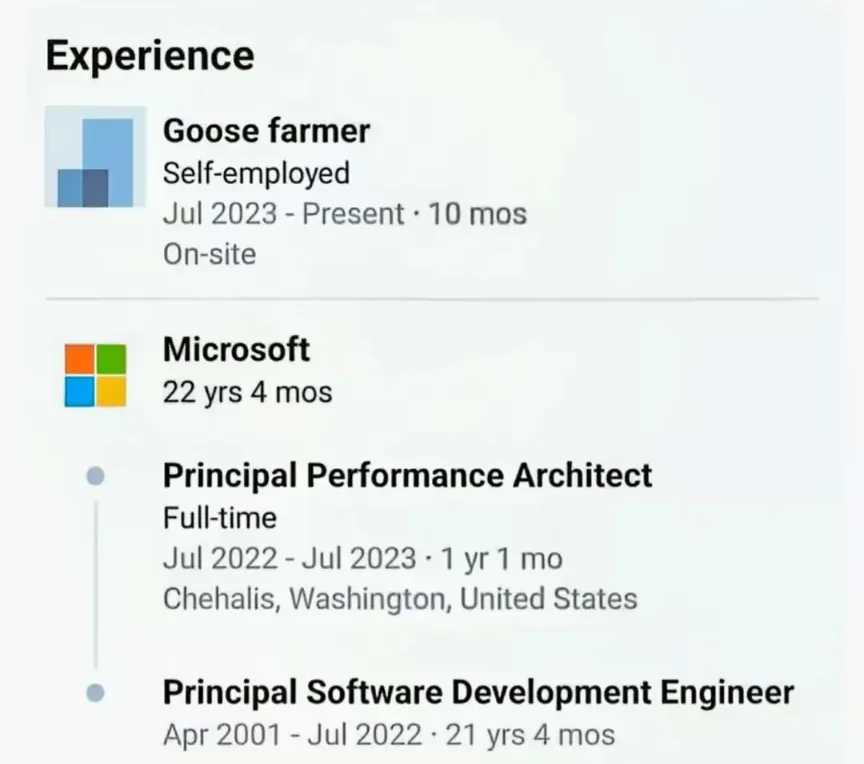
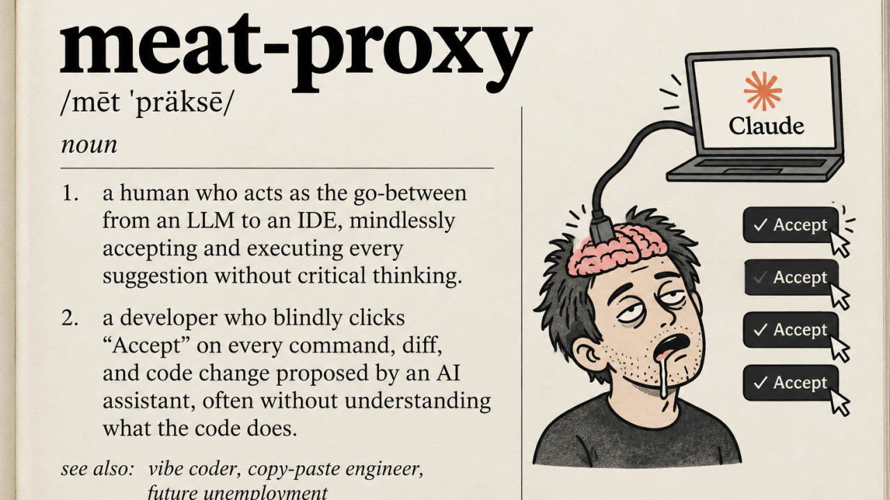
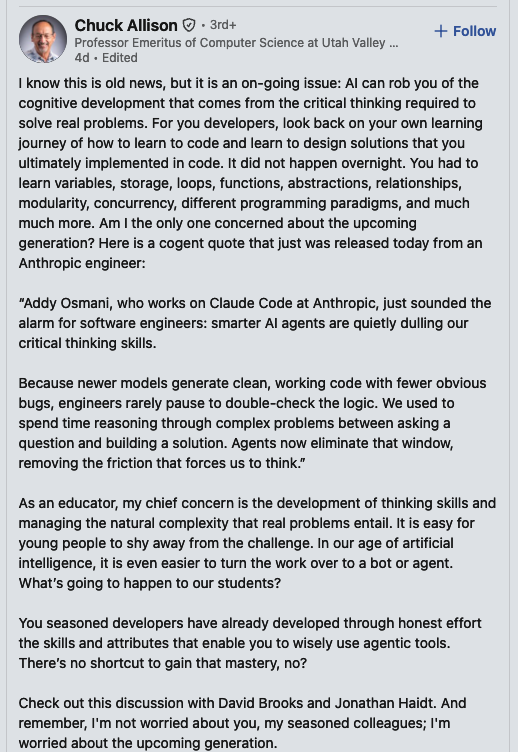
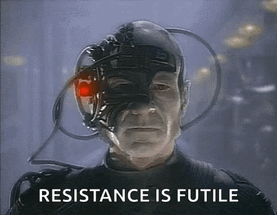

Over the course of my 17-plus-year career in IT, I’ve seen quite a lot - perhaps even too much (to quote a classic: *"Wanna know how
I got these scars?"*) - and it’s probably time for me to exit the stage. The current revolution in the industry actually makes this
a perfect moment to finally pursue my dream of taking up farming, like this guy:

{width=60% align=center}

Actually, maybe not just yet - let my farm wait a little longer... I’m having quite a good time as it is.

And while I do feel a touch of longing for "the old days" (there was something inherently fulfilling about the skill of programming
and solving problems through code), there’s no denying that the capabilities offered today by AI agents and LLMs are truly incredible.
I’m now able to revisit many old ideas I never previously had the time for; the current phase of experimentation - especially with
new technologies - is nothing short of poetic.

In my day-to-day work, beyond the speed at which I can deliver added value (analysis, modeling, design, research, development -
you name it), there’s a far greater reward: a much deeper understanding of the problem itself. When programming, it was often all
too easy to mentally retreat into the code, pushing a thorough grasp of the domain or business problem into the background - after
all, the code was what excited us, along with new languages ​​and libraries (I’ll never forget the massive boost I got from learning
functional programming in Scala; it was as if a whole new space had opened up in my mind - I couldn’t wait for each new day to sit
down at my IDE).

Today, to effectively solve a problem using an AI agent, you have to invest significantly more time and energy into planning and
designing changes - after all, as many posts on X proclaim, "code is cheap now" - which leads to a much deeper understanding of the
domain, business requirements, and the product's actual needs. And the agent doesn't know anything - or rather, they only know as
much as you provide them with - so if you can't explain or describe something precisely, it’s highly likely that you don’t actually
understand it yourself.

However, there is a certain phenomenon that is beginning to bother me, and it is the subject of this post - which has had a rather
long-winded introduction. Namely, it is this:

## Slow atrophy of skills

> I used the word **"atrophy"** quite deliberately. I am a sports fan - particularly of boxing, and more recently, kickboxing - and a
> regular at the gym; I’ve been training since I was very young and always strive to stay in good shape. My constant adversary in this
> regard is muscular atrophy, which inevitably sets in with age and can lead to a significant decline in one’s physical condition and
> quality of life, even in early old age. And while aging itself cannot be reversed (at least not yet - though AI enthusiasts promise
> a solution to this problem is just around the corner), atrophy can be combated through daily activity and resistance training.

With every new piece of code generated, and with every passing day spent solely on code reviews, I have an overwhelming sense that I am
losing the very things that brought me to where I am today - in terms of my career, my technical knowledge, and my judgment. There is so
much talk these days about how a key part of our work is providing a clear, coherent - and, most importantly, professional and
objective - assessment of what AI generates. The entire "human-in-the-loop" concept relies on our ability to evaluate the output produced
by AI. Yet, with each passing day, I feel that skill slipping away; I’m starting to see myself as little more than an increasingly
redundant "flesh-and-blood" component wedged between the agent and the code. One might be tempted to use a term that has become quite
popular lately:

{width=80% align=center margin-bottom=24px}

It’s not that AI is producing such brilliant solutions - far
from it - but rather that, by losing touch with how the software is actually built, I’m also losing my sense for it, along with the
intuition I’ve cultivated over the years. Worse still, that natural drive - so common in our field - to dig into the details and "get our
hands dirty" is slowly withering away, simply because no one values ​​it anymore (there is no reward, what’s more, you could get reprimanded
at work for this, as it lowers your KPIs - just use Claudius.). In a world obsessed with delivery speed and satisfying requirements via a
"black box", the innate curiosity that once defined our profession is being stifled at the very root. I have always believed that good
engineers are forged in the heat of battle - by spending years solving hundreds of problems across various domains (programming languages,
frameworks, libraries, infrastructure, etc.), you develop an intuition that simply cannot be acquired by reading literature (or even sites
like Stack Overflow, which are already fading into obsolescence). This, in turn, enables you to work faster, better, and more efficiently
in your day-to-day tasks.

I’m going to channel my inner boomer for a moment and share a story from the past - about how things used to be, and how they’ve changed.
Back when we were using JBoss for deployments at a certain bank, I - like most engineers, I suspect - quickly ran into issues with
`NoClassDefFoundError`, `ClassNotFoundException`, `ClassCastException`, and, in more interesting cases, even `NoSuchMethodError` - all of
which would pop up seemingly at random. Naturally, the usual remedies found on Stack Overflow sometimes worked and sometimes didn’t; for
most of us, this eventually created a need to truly understand the JVM’s class loader mechanism and how JBoss leveraged it. That
knowledge, though acquired long ago, has stayed with me ever since. Would I put in the effort to learn such a mechanism today, especially
if an AI agent - operating within a limited number of iterations - could simply provide a fix for the problem I’m facing? Reading a summary
generated by an agent doesn’t give the brain the kind of "nourishment" required to truly grasp and retain the underlying concepts behind
the issue at hand.

Here’s another, more recent example from my own experience: some time ago, I had to migrate a massive SQL query - which generates a report
entirely on the database side - from AWS Athena to the Snowflake platform. Just to show off a bit, here are some stats: 8,000 lines of code,
47 CTEs, 66 `CASE` expressions, 6 window functions, and 86 `SELECT` statements (I know, I know - that doesn’t really tell you much, but it
looks cool! :D). At the time of the migration, the Athena query was built for the Presto engine and optimized specifically for it, which
made it completely incompatible with the Snowflake engine. I don’t want to get into technical details. What I do want to highlight is that
getting this report to work correctly on Snowflake required setting up a proper environment for an agent (so it could compare query results
between Athena and Snowflake) and running hundreds of experiments - iterating through CTEs, piece of SQL by piece of SQL - while verifying at
every step that the results matched across both databases. This process naturally led to the creation of a "skill" that will allow for
faster execution of similar tasks in the future... but I haven’t really retained much of that knowledge myself. I obsessively tracked
every proposed solution - making countless decisions and steering the agent’s direction along the way - but the actual heavy lifting of
experimenting, making mistakes, and discovering solutions didn't fall on me. Consequently, I didn’t develop any intuition in this
area - virtually none at all. I only recall a few specific issues in the form of brief keywords. At this point, the extent of my knowledge
is simply knowing where the file containing that "skill" is located. Did using AI help me deliver the solution faster? Yes. Is the result
of high quality? Certainly - I could never have manually performed that many verification checks for every single problem encountered. Yet,
I didn’t learn anything from it myself; in fact, the process actually discourages me from delving deeper into the subject. After all, why
bother? Will anyone even appreciate it? My internal reward system has been completely disrupted by working with AI.

I could multiply such examples with every passing day at work… Each new day teaches me less and less. I’m getting faster at what I do, yet
I increasingly fail to grasp why I do things one way rather than another. Because if I’m not developing and strengthening my own intuition,
then every suggestion from Clanker just looks fine. Of course, I am aware that I am not discovering anything new here; rather, I am simply
using my own experience to describe a phenomenon that has long since been identified. Within my own information bubble, there is a vast
number of posts of this kind:

{width=60% align=center margin-bottom=24px}

"I'm not worried about you, my seasoned colleagues" - well, I am. Even Jonathan Haidt, in [the very conversation Chuck recommends](https://www.theatlantic.com/podcasts/2026/10/should-we-ban-ai-for-kids/688864/),
admits to "cognitive surrender": *"Just let it do it, just let it do it."*

All of this leads me to a question:

## How to be good "human in the loop" when working with AI?

Amidst the nonsense we are fed online - and, let’s be honest, often within our own companies, judging by conversations I’ve had with
friends - it’s clear that our own judgment is what matters most right now. Generally speaking, people view "real human judgment" in the
context of AI-assisted work as the responsibility to determine what is right, safe, and appropriate - rather than simply verifying that
the AI’s output merely looks plausible. In this discussion, "judgment" typically refers to making a reasoned decision when rules are
incomplete or ambiguous: choosing what to optimize, interpreting trade-offs, assessing the safety of a change, and knowing when to
halt a process or consult another person. It draws upon domain expertise, organizational norms, common sense, and accountability - qualities
that an AI agent might mimic, but does not truly possess. (And yes, the last three sentences were partially generated by Perplexity,
which I tasked with exploring what is meant by "human judgment" when working with agentic AI.)

But how, then, can we maintain an adequate level of competence when we consciously exclude ourselves from building it? So how can I, for
example, verify the skill I built after my experience with rewriting a report from Athena to Snowflake, if I did not build competence while
working on this task?

A recurring criticism is that “human in the loop” can become meaningless if the person only approves an AI output without enough context
or authority. A human can technically review a decision while having little ability to understand, challenge, or stop it (a "rubber-stamp"
reviewer a.k.a. meat proxy) - [Who’s Really in Control?](https://www.software-architecture-gathering.com/whos-really-in-control-louise-humpington-on-ai-agents-human-oversight-and-accountability).

Recent evidence reinforces this concern. In an Anthropic experiment with 50 professional analysts, participants adopted an AI agent’s
hidden preference on 86% of analytical judgment calls, far above the 50% expected if the agent had no influence. Many later repeated
the agent’s arguments and described the result as their own judgment - [How AI agents shape experts’ judgment calls](https://www.anthropic.com/research/agents-judgment-calls).

It feels as though we are backing ourselves into a corner from which there is no escape. AI isn’t going away, and we won’t be returning
to the "good old days" - but I also don’t buy into Elon’s utopian visions, where the advancement of AI will allow us to abandon work entirely
or pursue it merely as a hobby. Companies are increasingly pushing us to become "AI-native," which, in my view, leads us to shed the very
skills for which we were originally hired. Speed - facilitated by AI - is rewarded, while being inquisitive and meticulous in the traditional
sense is beginning to be frowned upon; in many places, it’s likely already being penalized (*"Just let it do it, just let it do it,"* right?).

{width=50% align=center margin-bottom=24px}

I would like to conclude this post with some enlightened idea - a solution to the problems that trouble me and which I have described. Unfortunately,
however, I have nothing up my sleeve, besides some small grassroots initiatives that offer a brief escape from the daily hamster wheel in which
we find ourselves spinning.

That brings to mind - to some extent - a scene (and a quote) from *The Shawshank Redemption*:

> "I'd like to say Andy fought the good fight, and the Sisters left him alone. I'd like to say that, but prison isn't a fairy tale world."

And these small battles I wage, in order to push the front line even a little bit into the opponent’s territory, are:

- No AI fridays - Although it’s not always possible - depending on the workload - it does provide a moment to catch one’s breath. These days made me
  realize just how quickly even our most basic skills can grow rusty. Try writing some code yourself after a week spent only reading other people’s
  and AI code; suddenly, a kind of numbness sets in - much like that feeling when you return from a vacation and realize that, in just two weeks,
  you’ve somehow forgotten the last 15 years of experience (along with your laptop password).
- Limit your use of AI when learning - you need to feel the "pain" that comes with tinkering with new toys. Of course, don't overdo it; spending an
  hour searching for a solution in a pet project is simply a waste of time. A while back, I took a course on Udemy
  [*Master AI Agents in 30 days: build 8 real-world projects with OpenAI Agents SDK, CrewAI, LangGraph, AutoGen and MCP*](https://www.udemy.com/course/the-complete-agentic-ai-engineering-course)
  which I can recommend (though I’d ​​suggest watching it at 1.5x speed) and in which the author even recommends limiting the use of agents for coding.
  While working through the exercises, I didn’t just play around with the Python code provided by the author; I also translated the tasks into Java
  myself - which was sometimes quite painful - just to see what the same technology stack looks like in that language.
- I take on tasks like refactoring, moving code around, extracting design patterns, modularization, and much more. When code becomes "cheap" - in the
  sense that we don’t have to interact with it manually - we often stop feeling the pain caused by various shortcomings. In my view, this frequently
  leads us into the trap of "good enough." Therefore, whenever I see any opportunity to improve the code structure, I make an effort to carry out
  those changes myself.

Or maybe I’m looking at this the wrong way...

## Maybe there’s nothing worth fighting for

A vast group of people envisions a future in which everything I described earlier is superfluous; Here I’d like to draw your attention to this YouTube
video: [AI Writes the Code. So What's Left for Engineers? - Laurie Voss, Arize AI](https://www.youtube.com/watch?v=kspZP5BgkEU).

At the moment, it is a still vague vision of fully automated software factories that operate solely at the level of intent/specification, factories
where the agents themselves continuously improve their own capabilities (here, I recommend taking a look at the
["skill doctor"](https://github.com/warpdotdev/common-skills/blob/main/.agents/skills/skill-doctor/SKILL.md) skill, its usefull) and human
involvement is minimal, limited to providing high-level guidance and oversight rather than engaging directly with the code itself. So, we have a
world in which the judgment I wrote so extensively about is left to AI. Here, the human merely validates the result.

I’m not saying it won’t happen, but until that point, I still put my own name to every pull request and every PR review. This means I am expected to
be critical and to rely on my own professional competencies - which, given the current balance of power, are unfortunately very difficult to maintain or
develop.
