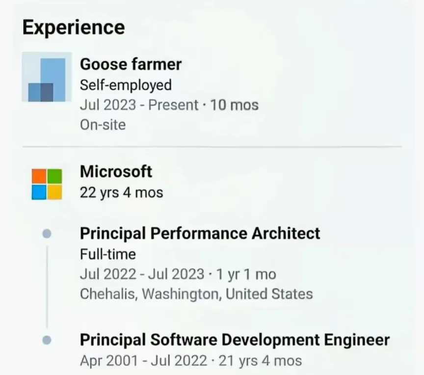
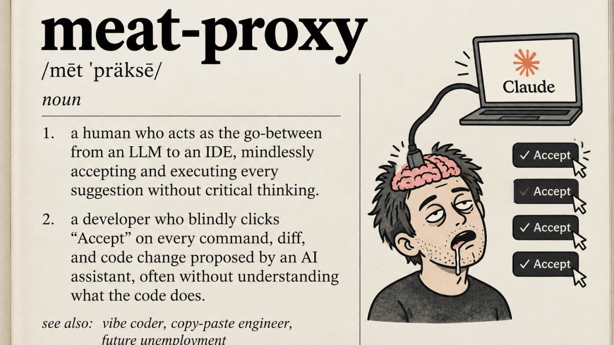

Over the course of my 17-plus-year career in IT, I’ve seen quite a lot - perhaps even too much (to quote a classic: *"Wanna know how
I got these scars?"*) - and it’s probably time for me to exit the stage. The current revolution in the industry actually makes this
a perfect moment to finally pursue my dream of taking up farming, like this guy:

{width=60% align=center}

Actually, maybe not just yet - let my farm wait a little longer... I’m having quite a good time as it is.

And while I do feel a touch of longing for "the old days" (there was something inherently fulfilling about the skill of programming
and solving problems through code), there’s no denying that the capabilities offered today by AI agents and LLMs are truly incredible.
I’m now able to revisit many old ideas I never previously had the time for; the current phase of experimentation - especially with
new technologies - is nothing short of poetic.

In my day-to-day work, beyond the speed at which I can deliver added value (analysis, modeling, design, research, development -
you name it), there’s a far greater reward: a much deeper understanding of the problem itself. When programming, it was often all
too easy to mentally retreat into the code, pushing a thorough grasp of the domain or business problem into the background - after
all, the code was what excited us, along with new languages ​​and libraries (I’ll never forget the massive boost I got from learning
functional programming in Scala; it was as if a whole new space had opened up in my mind - I couldn’t wait for each new day to sit
down at my IDE).

Today, to effectively solve a problem using an AI agent, you have to invest significantly more time and energy into planning and
designing changes - after all, as many posts on X proclaim, "code is cheap now" - which leads to a much deeper understanding of the
domain, business requirements, and the product's actual needs. And the agent doesn't know anything - or rather, they only know as
much as you provide them with - so if you can't explain or describe something precisely, it’s highly likely that you don’t actually
understand it yourself.

However, there is a certain phenomenon that is beginning to bother me, and it is the subject of this post - which has had a rather
long-winded introduction. Namely, it is this:

## Slow atrophy of skills

> I used the word **"atrophy"** quite deliberately. I am a sports fan - particularly of boxing, and more recently, kickboxing - and a
> regular at the gym; I’ve been training since I was very young and always strive to stay in good shape. My constant adversary in this
> regard is muscular atrophy, which inevitably sets in with age and can lead to a significant decline in one’s physical condition and
> quality of life, even in early old age. And while aging itself cannot be reversed (at least not yet - though AI enthusiasts promise
> a solution to this problem is just around the corner), atrophy can be combated through daily activity and resistance training.

With every new piece of code generated, and with every passing day spent solely on code reviews, I have an overwhelming sense that I am
losing the very things that brought me to where I am today - in terms of my career, my technical knowledge, and my judgment. There is so
much talk these days about how a key part of our work is providing a clear, coherent - and, most importantly, professional and
objective - assessment of what AI generates. The entire "human-in-the-loop" concept relies on our ability to evaluate the output produced
by AI. Yet, with each passing day, I feel that skill slipping away; I’m starting to see myself as little more than an increasingly
redundant "flesh-and-blood" component wedged between the agent and the code. One might be tempted to use a term that has become quite 
meat-popular lately:

{width=80% align=center}

It’s not that AI is producing such brilliant solutions - far
from it - but rather that, by losing touch with how the software is actually built, I’m also losing my sense for it, along with the
intuition I’ve cultivated over the years. Worse still, that natural drive - so common in our field - to dig into the details and "get our
hands dirty" is slowly withering away, simply because no one values ​​it anymore (there is no reward, what’s more, you could get reprimanded
at work for this, as it lowers your KPIs—just use Claudius.). In a world obsessed with delivery speed and satisfying requirements via a
"black box", the innate curiosity that once defined our profession is being stifled at the very root. I have always believed that good
engineers are forged in the heat of battle—by spending years solving hundreds of problems across various domains (programming languages,
frameworks, libraries, infrastructure, etc.), you develop an intuition that simply cannot be acquired by reading literature (or even sites
like Stack Overflow, which are already fading into obsolescence). This, in turn, enables you to work faster, better, and more efficiently
in your day-to-day tasks.

