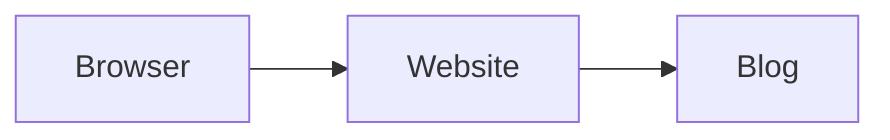

# Blog authoring

Place one Markdown file per article in `content/blog/`. Its filename becomes
the article URL: `my-article.md` becomes `/blog/my-article/`.

Every article requires this frontmatter:

```md
---
title: A clear article title
publishedAt: 2026-09-02
description: A short summary shown in the post menu, limited to two lines.
---

Your article content in Markdown starts here.
```

Posts are ordered by `publishedAt`, newest first. Add `draft: true` to keep an
article out of the public post list and generated site.

## Images and attachments

Folders are supported. Keep an article's images or other linked files anywhere
inside `content/blog/` and link them normally from Markdown, relative to the
article file:

```md

[Download the source](./my-article/example.zip)
```

On build, every non-Markdown file is copied to `/blog-assets/` with the same
folder structure. Local Markdown links are automatically rewritten to that
public path.

## Light and dark images

To show a different image depending on the page theme, save both variants
next to each other with `-light` and `-dark` suffixes and reference the light
one:

```md

```

If `screenshot-dark.webp` exists in the same folder, the page renders both and
shows the one matching the active theme (system preference or the theme menu).
Without a dark sibling the light image is shown as usual and the build prints a
warning.

## Image size, alignment and margin

Images fill the article width by default (never more than their natural size).
Add `{...}` directly after an image, with space-separated attributes in any order:

```md
{width=60% align=center}
{width=200px align=right margin=16px}
{margin-top=0 margin-bottom=2rem}
```

| Attribute | Values | Effect |
|---|---|---|
| `width` | length | Image width. |
| `align` | `left`, `right`, `center` | Places the image on its own line at that position. |
| `margin` | length or `0` | Space on all four sides. |
| `margin-top`, `margin-right`, `margin-bottom`, `margin-left` | length or `0` | Space on one side; overrides `margin` for that side. |

Lengths use `%`, `px`, `rem` or `em`; a bare number means pixels. Alignment
takes over the horizontal margin on the side it pushes away from (`center`
takes both), so `align=right margin-right=32px` keeps 32px from the right edge.
The image still shrinks on narrow screens. An invalid value fails the build.
Works for light/dark pairs too.

## Mermaid diagrams

Use a fenced `mermaid` block directly in an article. The build turns it into a
local SVG, so readers do not need JavaScript to see it.

````md

````
